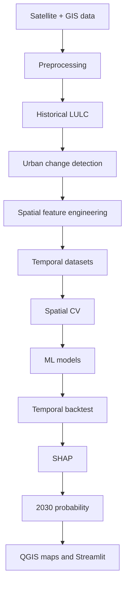

# Spatio-Temporal Urban Growth Prediction for Coimbatore

Reproducible GIS/ML project for observed urban expansion and a cautious 2030 urban-growth susceptibility surface. It never replaces missing sources or metrics with synthetic results.



## Setup

```powershell
python -m venv .venv
.\.venv\Scripts\Activate.ps1
pip install -r requirements.txt
python run_pipeline.py boundary
python run_pipeline.py osm
python run_pipeline.py scenes
python run_pipeline.py features
streamlit run app/app.py
```

The first stages download/record real geoBoundaries, OSM and cloud-filtered Landsat scene provenance. Inspect the resulting manifest before imagery download and compositing.

## Modelling

Create `data/processed/train_2015_2020.csv` and `data/processed/test_2020_2025.csv` from aligned 100 m cells. Both require `became_urban`, `x`, `y`, and historical-only numeric predictors; optional `block` controls spatial groups. Then run `python run_pipeline.py train`.

The selected model is chosen by mean spatial-CV PR-AUC across Logistic Regression, Random Forest and XGBoost. Its independent 2020→2025 backtest reports accuracy, precision, recall, F1, ROC-AUC, PR-AUC, confusion matrix and IoU.

## QGIS and limitations

Open `qgis/project/coimbatore_urban_growth.qgs`, which creates the required group taxonomy under EPSG:32643. QGIS MCP was unavailable in this session, so no QGIS-native operation is claimed as executed. The spectral-rule LULC helper is a transparent fallback, not ground truth; replace it with documented labelled or validated global LULC data for academic reporting. Probabilities express association, not causation or guaranteed development.
